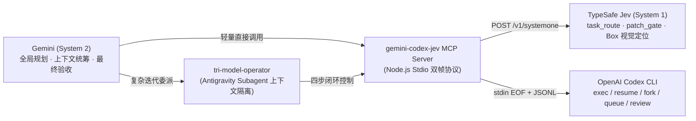

# Gemini × Jev × Codex 三模型协同编排套件 (`gemini-codex-jev`)

零第三方依赖的 Google Antigravity 全局插件，将 **Gemini（System 2 顶层思考与编排）**、**TypeSafe Jev（System 1 毫秒级校准决策门控）** 与 **OpenAI Codex CLI（沙盒执行、跨轮会话控制与 `multi_agent_v2` 子智能体）** 整合为统一闭环。

## 协同架构



## 核心特性

- **零依赖原生 Node.js 实现**：基于 Node.js `>=22.0.0` 内置模块，同时兼容换行分隔 JSON 与 LSP `Content-Length` 双帧 MCP 协议。
- **TypeSafe Jev (System 1) 门控**：内置 `task_route`（任务分流）与 `patch_gate`（补丁质量门禁）模板，支持自定义 `choice` / `noul` / `score` / `box` 与静态 PNG（`280..1568` 像素）多部分提交；自带规范化 SHA-256 缓存、单任务预算锁与 HTTP `CONNECT` 代理隧道兼容。
- **Codex CLI 全生命周期掌控**：自动定位本机完整版 Codex 可执行文件（Windows 支持扫描 `WindowsApps` 与 GitHub Desktop 内置 Git，macOS/Linux 支持 `PATH` 发现），自动读取 `models_cache.json` 选择可用模型，避免 `stdin` 管道阻塞与子命令参数冲突。
- **独立隔离执行子智能体**：内置 `tri-model-operator` 子智能体，将多轮单测与修复日志隔离在子会话中，仅向主会话返回精炼验收摘要。
- **专属 `/tri` 斜杠协同入口（v0.4.0）**：在聊天框输入 `/tri <任务>` 即可获得与 `/plan` 同等的两阶段协同体验——先完成只读调研、TypeSafe Jev `task_route` 路由与方案卡片生成，点击 Proceed 确认后自动执行 Codex 沙盒编码与 Jev/Codex 双重门禁验收。
- **Antigravity 顶栏 Codex 额度胶囊（v0.4.0）**：按 `usage-monitor v1.5.5` 规格对齐 CSS tokens、双环胶囊、浮层几何与 keyframes；自动同步浅色/深色、Modern UI、字体缩放及顶栏布局。具备冷启动 `<100ms` 秒级首屏挂载、脱敏快照缓存、心跳式热备租约接管、多会话回溯扫描、跨重置时间点自动归零、以及基于递增序号的展开自动保鲜/右键强刷。

## 环境要求

1. **Node.js `>= 22.0.0`**（支持内置 `fetch`、`FormData` 与 `--use-env-proxy`）
2. **OpenAI Codex CLI**（已安装并在本地完成 `codex login` 认证）
3. **TypeSafe API Key（可选，启用 Jev 判别时配置）**：设置用户环境变量 `TYPESAFE_API_KEY`

## 安装方式

将本仓库克隆至 Antigravity 全局插件目录即可自动加载生效：

- **macOS / Linux**：
  ```bash
  git clone https://github.com/Howardyh/gemini-codex-jev.git ~/.gemini/config/plugins/gemini-codex-jev
  ```
- **Windows (PowerShell)**：
  ```powershell
  git clone https://github.com/Howardyh/gemini-codex-jev.git "$env:USERPROFILE\.gemini\config\plugins\gemini-codex-jev"
  ```

安装后开启新会话即可在 Antigravity 中直接调用以下组件：
- **斜杠命令**：`/tri`（三模型协同两阶段规划与执行入口）
- **MCP 工具**：`jev_judge`、`codex_exec`、`codex_continue`、`codex_review`、`bridge_status`
- **子智能体**：`tri-model-operator`
- **技能**：`tri`、`tri-model-synergy`
- **协同准则**：`rules/AGENTS.md`

## 暴露的 MCP 工具 (`bridge`)

| 工具名 | 核心功能 |
| :--- | :--- |
| `jev_judge` | 调用 TypeSafe System One 接口（支持 `task_route` / `patch_gate` / `box` 图像定位、`dry_run` 与单任务缓存保护）。 |
| `codex_exec` | 启动非交互式 Codex 执行任务，支持沙盒策略、推理强度、`enable_subagents`（`multi_agent_v2`）与 `--worktree`。 |
| `codex_continue` | 基于 `thread_id` 执行 `resume`（原上下文续接修复）、`fork`（分支探索）或 `queue`（队列消息投递）。 |
| `codex_review` | 运行 `codex exec review` 对未提交变更、`base` 分支、`commit` 或自定义聚焦提示进行独立审查（非 Git 目录自动降级）。 |
| `bridge_status` | 执行 `doctor` 诊断（Codex 路径、可用模型、Git 路径、密钥与额度快照）、`quota` 实时拉取 Codex 5h/7d 剩余额度、`active` 查看运行中进程、`cancel` 终止卡死任务。 |

## 离线测试

运行内置离线测试套件（包含 MCP 双帧协议握手、SHA-256 规范化、`dry_run` 预览、PNG 校验、额度分级与倒计时、注入脚本语法/结构及 PII 检查，零网络请求与 API 费用）：

```bash
npm test
```

## License

MIT
